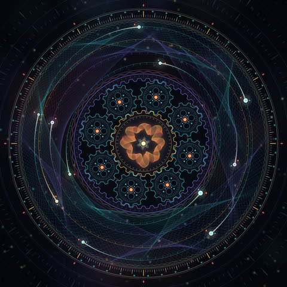
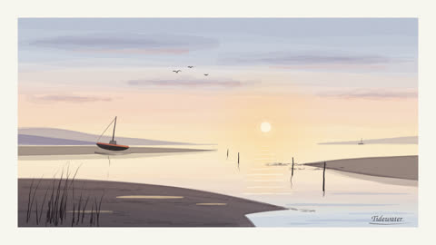
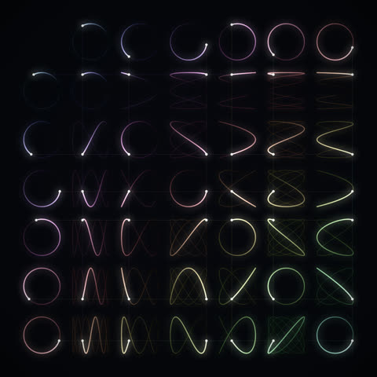
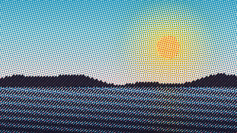
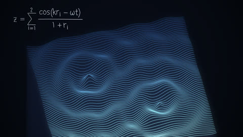
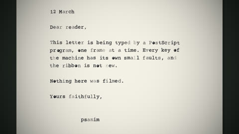
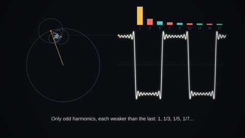
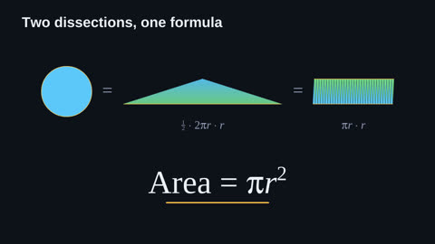
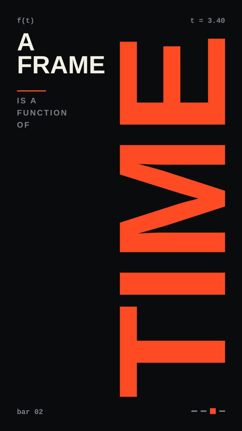
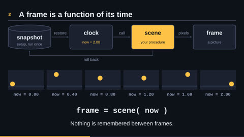

# Gallery

Generated by `scripts/build_site.py` from each piece's declaration. The films themselves are
rendered by `scripts/build_gallery.sh` into `site/gallery/` (not kept in git: they are
reproducible from the sources).

| | Piece | What it is | Shape | Render |
|---|---|---|---|---|
|  | [Orrery](../gallery/orrery/orrery.ps) | A planetary gear train, precessing orbit rings and noise-bent string art: a seamless 12 second loop. | 12 s, 1080x1080, pure | `psanim render gallery/orrery/orrery.ps -o orrery.mp4` |
|  | [Afterglow](../gallery/afterglow/afterglow.ps) | Opening titles for an imaginary film: credits over a setting sun, and a title that draws itself on. | 19.9 s, 1280x720, pure | `psanim render gallery/afterglow/afterglow.ps -o afterglow.mp4` |
|  | [Paper Boat](../gallery/paper-boat/paper-boat.ps) | A paper boat is folded, launched in the rain, lost down a drain, and found again on a calm river under stars. | 41.6 s, 1280x720, pure | `psanim render gallery/paper-boat/paper-boat.ps -o paper-boat.mp4` |
|  | [Tidewater](../gallery/tidewater/tidewater.ps) | A watercolour estuary at sunrise that paints itself, wash by wash and stroke by stroke. | 24 s, 1280x720, persistent | `psanim render gallery/tidewater/tidewater.ps -o tidewater.mp4` |
|  | [Murmuration](../gallery/murmuration/murmuration.ps) | Twelve hundred simulated starlings fold and pour over a fen at dusk. | 26 s, 1280x720, stateful | `psanim render gallery/murmuration/murmuration.ps -o murmuration.mp4` |
|  | [Taiji](../gallery/taiji/taiji.ps) | A yin-yang whose eyes are yin-yangs, turning, all the way down: a seamless 24 second loop. | 24 s, 1080x1080, pure | `psanim render gallery/taiji/taiji.ps -o taiji.mp4` |
|  | [Chalk Proof](../gallery/chalk-proof/chalk-proof.ps) | Pythagoras on a green board: a square cut two ways, and the algebra beside it, written in chalk a stroke at a time. | 37 s, 1280x720, persistent | `psanim render gallery/chalk-proof/chalk-proof.ps -o chalk-proof.mp4` |
|  | [Tesseract](../gallery/tesseract/tesseract.ps) | A hypercube turned in each of the six planes of four dimensions, then in two at once: a seamless 28 second loop. | 28 s, 1080x1080, pure | `psanim render gallery/tesseract/tesseract.ps -o tesseract.mp4` |
|  | [Lissajous](../gallery/lissajous/lissajous.ps) | The Lissajous table: twelve wheels and the 36 curves their pairs draw, as comets on a seamless 16 second loop. | 16 s, 1080x1080, pure | `psanim render gallery/lissajous/lissajous.ps -o lissajous.mp4` |
|  | [Halftone](../gallery/halftone/halftone.ps) | A sun rising and setting over the sea, printed in four misregistered ink screens whose dots are functions of time. | 16 s, 1280x720, pure | `psanim render gallery/halftone/halftone.ps -o halftone.mp4` |
|  | [Neon](../gallery/neon/neon.ps) | A neon sign strikes letter by letter, buzzes, and is switched off: a 12 second loop in PSCat's tube font. | 12 s, 1280x720, pure | `psanim render gallery/neon/neon.ps -o neon.mp4` |
|  | [Ripple](../gallery/ripple/ripple.ps) | Two wave sources interfering on a surface drawn as ridge lines, with its formula: a 10 second loop. | 10 s, 1280x720, pure | `psanim render gallery/ripple/ripple.ps -o ripple.mp4` |
|  | [Letter](../gallery/letter/letter.ps) | A letter typed by PSCat's typewriter, one strike at a time, on paper that climbs with each carriage return. | 25 s, 1280x720, pure | `psanim render gallery/letter/letter.ps -o letter.mp4` |
|  | [Epicycles](../gallery/epicycles/epicycles.ps) | A square wave assembled from rotating circles. | 22 s, 1280x720, pure | `psanim render gallery/epicycles/epicycles.ps -o epicycles.mp4` |
|  | [One Frame, Any Time](../gallery/one-frame/one-frame.ps) | How psanim renders a movie: setup, checkpoint, and frames as functions of time. | 40.5 s, 1280x720, pure | `psanim render gallery/one-frame/one-frame.ps -o one-frame.mp4` |
|  | [Twenty-Three](../gallery/birthday/birthday.ps) | The birthday problem as a data story: the guess of 183 people, the exact answer of 23, the 253 pairs that explain it, and 100,000 simulated rooms. | 67 s, 1280x720, pure | `psanim render gallery/birthday/birthday.ps -o birthday.mp4` |
|  | [Canon](../gallery/canon/canon.ps) | A scene that contains itself: seven voices, each a quarter turn round, in another theme, three quarters of a second behind the last. | 12 s, 1294x800, pure | `psanim render gallery/canon/canon.ps -o canon.mp4` |
|  | [Circle Area](../gallery/circle-area/circle-area.ps) | Why the area of a circle is pi r squared, shown twice: rings unrolled into a triangle, wedges meshed into a rectangle. | 63 s, 1280x720, pure | `psanim render gallery/circle-area/circle-area.ps -o circle-area.mp4` |
|  | [Departures](../gallery/departures/departures.ps) | A station departures board updating: it fills from blank, trains are called, one is delayed and one cancelled, the first leaves and the whole board turns over. Split-flap and odometer catalog entries. | 26 s, 1280x720, pure | `psanim render gallery/departures/departures.ps -o departures.mp4` |
|  | [Fresh](../gallery/fresh/fresh.ps) | Kinetic type on a 120 bpm grid: a frame is a function of time, nothing is remembered, and the motion lives in whoever is watching. | 34 s, 1080x1920, pure | `psanim render gallery/fresh/fresh.ps -o fresh.mp4` |
|  | [Heron](../gallery/heron/heron.ps) | A haiku in ink and wash: hills, reeds and a heron paint themselves stroke by stroke on paper while kinetic type sets the words and a vector sun crosses the sky. | 46 s, 1280x720, persistent | `psanim render gallery/heron/heron.ps -o heron.mp4` |
|  | [How psanim works](../gallery/how-it-works/how-it-works.ps) | An animated architecture explainer of psanim itself: a movie is one PostScript program, a frame is a function of its time, time scopes re-base the clock, frames render in any order on every core, and the stack from program to video. | 69.5 s, 1280x720, pure | `psanim render gallery/how-it-works/how-it-works.ps -o how-it-works.mp4` |
|  | [News Sign](../gallery/news-sign/news-sign.ps) | A scrolling LED news sign on a brick wall at night: headlines, scores, the time and the temperature, each arriving its own way, with a scores ticker below. | 39.9 s, 1280x720, pure | `psanim render gallery/news-sign/news-sign.ps -o news-sign.mp4` |

Each piece's directory has a README describing its techniques.
